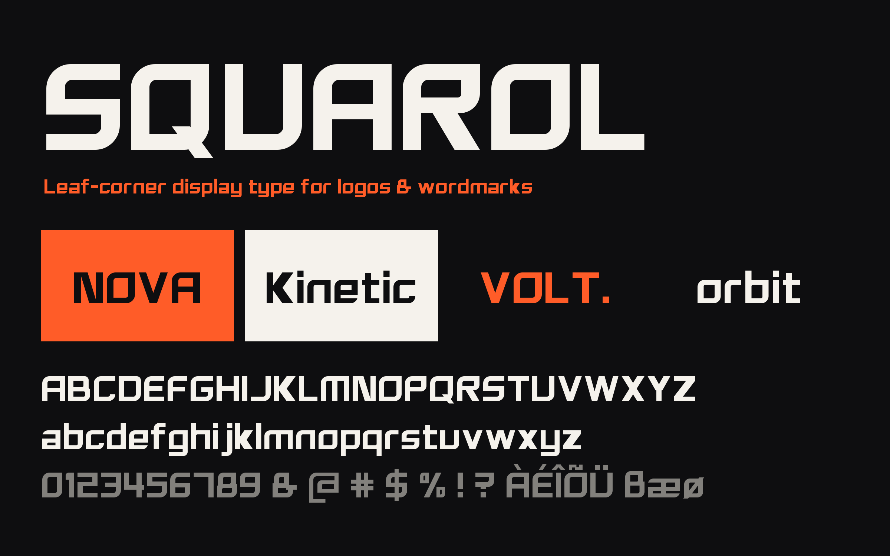

# Squarol



Squarol is a heavy, wide, rounded-square display typeface for logos, wordmarks, headlines and packaging.
Its signature is the **leaf corner**: corners on the top-left / bottom-right diagonal are rounded,
the other two stay sharp, so words feel like they are moving forward.

- Style: Regular (heavy display)
- Coverage: Google Fonts Latin Core (324 glyphs)
- License: SIL Open Font License 1.1 (see `OFL.txt`)

## Building

```sh
pip install -r requirements.txt
sh build.sh          # writes fonts/ttf/Squarol-Regular.ttf
```

The glyphs are drawn parametrically in Python (`glyphs.py`, `glyphs2.py`, `composites.py`),
written to a UFO in `sources/`, then compiled with fontmake.

## Testing

```sh
fontbakery check-googlefonts fonts/ttf/Squarol-Regular.ttf
```

## Copyright

Copyright 2026 The Squarol Project Authors (https://github.com/TOMOOLY/squarol). Designed by tom.
